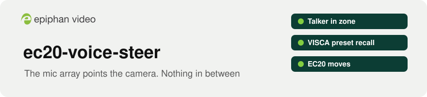
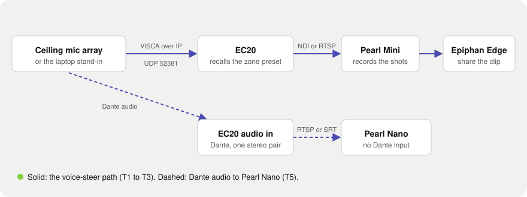

<p align="center">
  <picture>
    <source media="(prefers-color-scheme: dark)" srcset="docs/assets/banner-dark.svg">
    
  </picture>
</p>

<p align="center">
  <a href="https://github.com/ScientiaCapital/ec20-voice-steer/actions/workflows/ci.yml"></a>
  
  <a href="LICENSE"></a>
  
</p>

<p align="center">
  <a href="#what-it-tests">What it tests</a> ·
  <a href="#how-it-fits-together">How it fits together</a> ·
  <a href="#quick-start">Quick start</a> ·
  <a href="docs/test-plan.md">Test plan</a> ·
  <a href="SECURITY.md">Security</a>
</p>

# ec20-voice-steer

Voice-steered camera presets on an Epiphan EC20, with no tracking processor in the rack.

A consulting AV designer asked whether a Dante ceiling microphone array, such as the Audio-Technica ATND1061DAN, can point an EC20 on its own. The array knows which zone a talker is in and can send a VISCA over IP preset recall when that changes. The EC20 takes VISCA over IP on UDP 52381, a port that can't be changed ([EC20 network settings](https://kb.epiphan.com/ec20/ec20-network-settings)). If the EC20 accepts the recall, the reference design is the array and the EC20, with nothing in between.

Rooms are often specified today with a tracking processor whose only job is to turn "the audio says zone 2" into "camera, go to preset 2". If the array can tell the EC20 directly, that line item goes away. This repo tests whether the EC20's existing VISCA preset path is enough, with no firmware work.

## What it tests

| Test | Question | State |
|---|---|---|
| T1 | Does the EC20 accept a VISCA over IP preset recall from any sender on the network? | Built, not yet run on a real EC20 |
| T2 | Does zone to preset routing work, including two talkers going back and forth? | Built with a laptop standing in for the array |
| T3 | Does Pearl Mini record the shot changes, and can Epiphan Edge share the clip? | Bench test, no code needed |
| T4 | Does a real ceiling array do the same thing? | Waiting on an array |
| T5 | Can the EC20 bring the array's Dante audio to a Pearl Nano, which has no Dante input? | Bench test |

Each row is written out in the [test plan](docs/test-plan.md), with a place for the results.

## How it fits together

<p align="center">
  <picture>
    <source media="(prefers-color-scheme: dark)" srcset="docs/assets/architecture-dark.svg">
    
  </picture>
</p>

The laptop stand-in sends the same bytes the array would, so a pass on the bench carries over to a real array. Pearl Mini takes the EC20 in as a network source and records, and Epiphan Edge gives remote access to that recording. Neither step needs code.

The EC20 also takes Dante audio in, two channels (one stereo pair), and has no Dante output ([EC20 feature list](https://kb.epiphan.com/ec20/ec20-feature-list)). Pearl Nano takes one RTSP or SRT source at a time, with audio embedded. T5 tests whether one array can both steer the camera and feed the room audio through it to a Pearl Nano, with no Dante adapter in the rack.

What's verified, what's a bench test, and what's still unknown is in [docs/ARCHITECTURE.md](docs/ARCHITECTURE.md).

## Quick start

You need a bench EC20 on the same network as your laptop. Don't point this at a camera in a room someone is using.

```bash
git clone https://github.com/ScientiaCapital/ec20-voice-steer.git && cd ec20-voice-steer
uv sync --group dev
cp .env.example .env               # set EC20_STEER_IP to the bench EC20
uv run ec20-steer version          # a safe first check: ACK or a timeout
uv run ec20-steer save 1           # save the current position as preset 1
# move the camera in the EC20 web interface, then
uv run ec20-steer save 2
uv run ec20-steer recall 1         # the camera should move back
uv run ec20-steer route            # keys 1 to 9 are zones, 0 is wide, q quits
```

`save` overwrites a preset on the camera. `route --mic` uses a crude laptop mic level trigger instead of keys, and needs `uv sync --extra mic`. Zones and the debounce are in `src/ec20_voice_steer/zones.default.json`, and `route --config` takes your own file.

To see what a ceiling array sends before it ever reaches the camera, run the laptop as a fake EC20:

```bash
uv run ec20-steer listen           # decode each VISCA packet on UDP 52381, answer like a camera
```

Point the array's camera control target at the laptop. Each packet is printed and decoded, flagged when it has no VISCA over IP header, an unrecognized message, or a sequence jump, and compared byte for byte with what `ec20-steer` sends. The listener answers only requests it recognizes, and each line says what it sent back. `listen --no-reply` decodes without answering, and `listen --port N` picks another port. `listen` reads nothing from `.env` and sends nothing to a camera. By default it binds 127.0.0.1, so only this machine can reach it. To hear an array, pass `listen --bind` with the laptop's bench network address (or `0.0.0.0` for every interface). It then answers any sender that can reach that address, so run it on the bench network, from the repo root so `docs/run.log` stays gitignored.

The camera address must be one IP address, not a host name. Multicast, broadcast and unspecified addresses are refused. A public (non-private) address is refused unless you pass `--allow-public`. Each reply is matched to its request by sequence number, and a reply with another number is dropped.

To work on the code without a camera:

```bash
uv run pytest -q                   # unit tests, no network
bash tests/hook-test.sh            # Edge write guard, redaction and secrets hook
uv run ruff check . && uv run ruff format --check .
```

| Path | What it is |
|---|---|
| `src/ec20_voice_steer/` | The package: VISCA over IP, the zone router, settings, and the `ec20-steer` command |
| `docs/test-plan.md` | The bench tests and the open questions |
| `docs/assets/`, `scripts/build_readme_art.py` | The README banner and diagram, built from Epiphan Brand colors and the official logos |
| `.claude/settings.json`, `.claude/hooks/` | Edge write guard, redaction and secrets hooks for Claude Code |
| `tests/` | Unit tests and the hook and permission tests, with redaction cases shared with Fleetwatch |
| `.env.example` | The settings `ec20-steer` reads. Copy it to `.env`, which is gitignored |
| `AGENTS.md`, `CONTRIBUTING.md` | The rules for AI assistants and for people. They're the same rules |

## Working with Claude Code and Epiphan Edge

The project folder includes the same safety hooks as the [Epiphan Edge Claude Kit](https://github.com/ScientiaCapital/epiphan-edge-claude-kit). Reads run without asking. Every Edge write asks first. Stream keys and passwords are replaced with a placeholder before Claude sees them, and bypass mode is off. `EPIPHAN_READ_ONLY=1 claude` blocks every Edge write outright.

VISCA commands go straight to the camera and don't pass through Epiphan Edge, so the Edge write guard doesn't cover them. The trust model and known limits are in [SECURITY.md](SECURITY.md).

## Data handling

Bench runs can name rooms, people, and camera addresses. None of that belongs in this repository. `docs/run.log`, where `route` appends each recall, is gitignored, and so is `.env`. Tests use the documentation address range `192.0.2.0/24` and run without a network.

## Development

Python 3.12, uv, ruff, and pytest. Work on a branch and open a pull request with the commands you ran and their output. Commit messages follow Conventional Commits. CI runs lint, tests on Linux and macOS, the hook and permission tests, and a gitleaks scan of the full history. Main needs a second reviewer.

To rebuild the README art after a change, run `python3 scripts/build_readme_art.py`.

## Status

Proof of concept. Built: the VISCA over IP client, the zone router with its debounce, the key and mic stand-ins, and the fake EC20 listener, all tested without a network. Not yet done: any run against a real EC20. Next steps: T1 on a bench EC20, then T2 with the back and forth rows, then T5.

## License

Copyright 2026 Epiphan Systems Inc. Licensed under the [Apache License 2.0](LICENSE); see [NOTICE](NOTICE) for third-party components.

ec20-voice-steer is not an officially supported Epiphan product. Epiphan, Epiphan Edge, Pearl, Pearl Mini, Pearl Nano, and EC20 are trademarks of Epiphan Systems Inc. Dante is a trademark of Audinate. Audio-Technica is a trademark of its owner.
